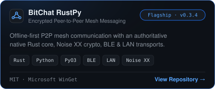
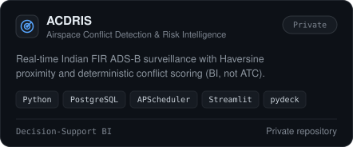
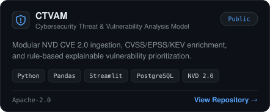
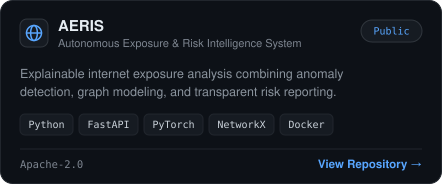
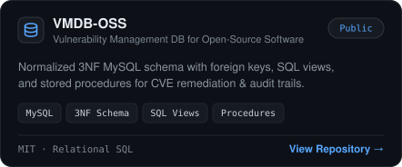
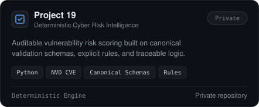
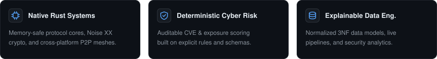
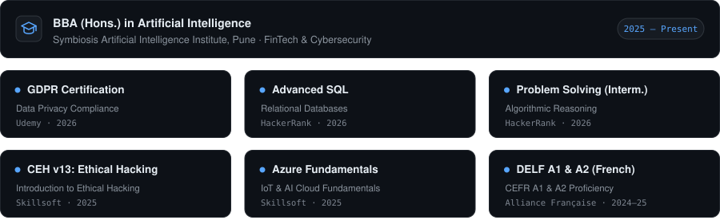

  <picture>
    <source media="(prefers-color-scheme: dark)" srcset="./assets/header-dark.svg" />
    <source media="(prefers-color-scheme: light)" srcset="./assets/header-light.svg" />
    
  </picture>

 

  &nbsp;
  &nbsp;
  &nbsp;
  &nbsp;
  

 

---

### About

- AI undergraduate (`BBA Hons.`) at **Symbiosis Artificial Intelligence Institute, Pune**
- Focused on **FinTech**, **Cybersecurity**, and **deterministic risk intelligence**
- Engineering explainable pipelines, normalized security databases, and auditable scoring models
- Building practical systems across native **Rust + Python** networking and vulnerability analytics

---

### Tech Stack

  &nbsp;&nbsp;&nbsp;
  <picture>
    <source media="(prefers-color-scheme: dark)" srcset="./assets/rust-dark.svg" />
    <source media="(prefers-color-scheme: light)" srcset="https://cdn.jsdelivr.net/gh/devicons/devicon@latest/icons/rust/rust-original.svg" />
    
  </picture>&nbsp;&nbsp;&nbsp;
  &nbsp;&nbsp;&nbsp;
  &nbsp;&nbsp;&nbsp;
  &nbsp;&nbsp;&nbsp;
  &nbsp;&nbsp;&nbsp;
  &nbsp;&nbsp;&nbsp;
  &nbsp;&nbsp;&nbsp;
  &nbsp;&nbsp;&nbsp;
  <picture>
    <source media="(prefers-color-scheme: dark)" srcset="./assets/pandas-dark.svg" />
    <source media="(prefers-color-scheme: light)" srcset="https://cdn.jsdelivr.net/gh/devicons/devicon@latest/icons/pandas/pandas-original.svg" />
    
  </picture>&nbsp;&nbsp;&nbsp;
  &nbsp;&nbsp;&nbsp;
  &nbsp;&nbsp;&nbsp;
  &nbsp;&nbsp;&nbsp;
  &nbsp;&nbsp;&nbsp;
  &nbsp;&nbsp;&nbsp;
  <picture>
    <source media="(prefers-color-scheme: dark)" srcset="./assets/scikitlearn-dark.svg" />
    <source media="(prefers-color-scheme: light)" srcset="https://cdn.jsdelivr.net/gh/devicons/devicon@latest/icons/scikitlearn/scikitlearn-original.svg" />
    
  </picture>&nbsp;&nbsp;&nbsp;
  &nbsp;&nbsp;&nbsp;
  &nbsp;&nbsp;&nbsp;
  &nbsp;&nbsp;&nbsp;
  &nbsp;&nbsp;&nbsp;
  <picture>
    <source media="(prefers-color-scheme: dark)" srcset="./assets/github-dark.svg" />
    <source media="(prefers-color-scheme: light)" srcset="https://cdn.jsdelivr.net/gh/devicons/devicon@latest/icons/github/github-original.svg" />
    
  </picture>&nbsp;&nbsp;&nbsp;
  &nbsp;&nbsp;&nbsp;
  

  Ecosystem &amp; Tooling: PyO3 · Maturin · APScheduler · pydeck · SQLAlchemy · ReportLab

---

### Featured Projects

  <a href="https://github.com/Java-Mx/bitchat-rustpy">
    <picture>
      <source media="(prefers-color-scheme: dark)" srcset="./assets/projects/bitchat-dark.svg" />
      <source media="(prefers-color-scheme: light)" srcset="./assets/projects/bitchat-light.svg" />
      
    </picture>
  </a>&nbsp;
  <picture>
    <source media="(prefers-color-scheme: dark)" srcset="./assets/projects/acdris-dark.svg" />
    <source media="(prefers-color-scheme: light)" srcset="./assets/projects/acdris-light.svg" />
    
  </picture>

  <a href="https://github.com/Java-Mx/CTVAM-VulnerabilityAnalysisModel">
    <picture>
      <source media="(prefers-color-scheme: dark)" srcset="./assets/projects/ctvam-dark.svg" />
      <source media="(prefers-color-scheme: light)" srcset="./assets/projects/ctvam-light.svg" />
      
    </picture>
  </a>&nbsp;
  <a href="https://github.com/Java-Mx/Internet-Exposure-Engine">
    <picture>
      <source media="(prefers-color-scheme: dark)" srcset="./assets/projects/aeris-dark.svg" />
      <source media="(prefers-color-scheme: light)" srcset="./assets/projects/aeris-light.svg" />
      
    </picture>
  </a>

  <a href="https://github.com/Java-Mx/VMDB-OpenSourceSoftware">
    <picture>
      <source media="(prefers-color-scheme: dark)" srcset="./assets/projects/vmdb-dark.svg" />
      <source media="(prefers-color-scheme: light)" srcset="./assets/projects/vmdb-light.svg" />
      
    </picture>
  </a>&nbsp;
  <picture>
    <source media="(prefers-color-scheme: dark)" srcset="./assets/projects/project19-dark.svg" />
    <source media="(prefers-color-scheme: light)" srcset="./assets/projects/project19-light.svg" />
    
  </picture>

---

### Contribution Activity

<a href="https://github.com/Java-Mx">
  <picture>
    <source media="(prefers-color-scheme: dark)" srcset="./assets/contrib-dark.svg" />
    <source media="(prefers-color-scheme: light)" srcset="./assets/contrib-light.svg" />
    
  </picture>
</a>

  

<a href="https://github.com/Java-Mx">
  <picture>
    <source media="(prefers-color-scheme: dark)" srcset="./assets/activity-dark.svg" />
    <source media="(prefers-color-scheme: light)" srcset="./assets/activity-light.svg" />
    
  </picture>
</a>

Auto-updated daily via GitHub GraphQL for <a href="https://github.com/Java-Mx">@Java-Mx</a> · View full public &amp; private calendar on <a href="https://github.com/Java-Mx">GitHub</a>.

---

### GitHub Statistics

---

### Current Focus

  <picture>
    <source media="(prefers-color-scheme: dark)" srcset="./assets/focus-dark.svg" />
    <source media="(prefers-color-scheme: light)" srcset="./assets/focus-light.svg" />
    
  </picture>

---

### Education & Certifications

  <picture>
    <source media="(prefers-color-scheme: dark)" srcset="./assets/credentials-dark.svg" />
    <source media="(prefers-color-scheme: light)" srcset="./assets/credentials-light.svg" />
    
  </picture>

---

  &nbsp;
  &nbsp;
  &nbsp;
  &nbsp;
  

  Ashwin Chhawaniya · Pune, India

