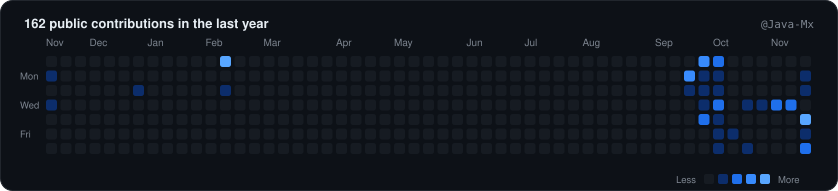
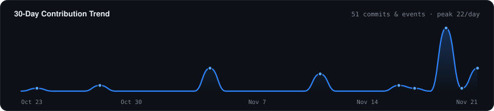

<picture>
  <source media="(prefers-color-scheme: dark)" srcset="./assets/header-dark.svg" />
  <source media="(prefers-color-scheme: light)" srcset="./assets/header-light.svg" />
  
</picture>

 

---

### About

- AI undergraduate (`BBA Hons.`) at **Symbiosis Artificial Intelligence Institute, Pune**
- Focused on **FinTech**, **Cybersecurity**, and **deterministic risk intelligence**
- Engineering explainable pipelines, normalized security databases, and auditable scoring models
- Building practical systems across native **Rust + Python** networking and vulnerability analytics

> **Currently exploring:** Native Rust (`PyO3` / `Maturin`) · Cross-platform BLE/LAN mesh systems · Deterministic CVE & exposure intelligence

---

### Tech Stack

  <picture>
    <source media="(prefers-color-scheme: dark)" srcset="https://skillicons.dev/icons?i=py,rust,html,css,js,postgres,mysql,sqlite,fastapi,sklearn,pytorch,docker,git,github,linux,githubactions&perline=16&theme=dark" />
    <source media="(prefers-color-scheme: light)" srcset="https://skillicons.dev/icons?i=py,rust,html,css,js,postgres,mysql,sqlite,fastapi,sklearn,pytorch,docker,git,github,linux,githubactions&perline=16&theme=light" />
    
  </picture>
  &nbsp;
  <picture>
    <source media="(prefers-color-scheme: dark)" srcset="./assets/pandas-dark.svg" />
    <source media="(prefers-color-scheme: light)" srcset="https://cdn.jsdelivr.net/gh/devicons/devicon@latest/icons/pandas/pandas-original.svg" />
    
  </picture>
  
  
  
  
  
  
  
  
  

---

### Featured Projects

<table>
  <tr>
    <td width="50%" valign="top">
      <strong><a href="https://github.com/Java-Mx/bitchat-rustpy">BitChat RustPy</a></strong> &nbsp; 
      Encrypted Peer-to-Peer Mesh Messaging  
      Offline-first P2P mesh communication with an authoritative native Rust core, Noise XX cryptography, BLE &amp; LAN transports, and Microsoft WinGet distribution.  
      <code>Rust</code> <code>Python</code> <code>PyO3</code> <code>BLE</code> <code>LAN</code> <code>Noise XX</code>  
      <a href="https://github.com/Java-Mx/bitchat-rustpy"><strong>View Repository &rarr;</strong></a> &nbsp;·&nbsp; <a href="https://java-mx.github.io/bitchat-rustpy/"><strong>Docs &rarr;</strong></a>
    </td>
    <td width="50%" valign="top">
      <strong>ACDRIS</strong> &nbsp; 
      Airspace Conflict Detection &amp; Risk Intelligence System  
      Real-time ADS-B surveillance across the Indian FIR with Haversine proximity and deterministic conflict scoring (BI decision-support layer, not ATC).  
      <code>Python</code> <code>PostgreSQL</code> <code>APScheduler</code> <code>Streamlit</code> <code>pydeck</code>  
      <em>Private / not currently published</em>
    </td>
  </tr>
  <tr>
    <td width="50%" valign="top">
      <strong><a href="https://github.com/Java-Mx/CTVAM-VulnerabilityAnalysisModel">CTVAM</a></strong> &nbsp; 
      Cybersecurity Threat &amp; Vulnerability Analysis Model  
      Modular NVD CVE 2.0 ingestion, CVSS/EPSS/KEV enrichment, and rule-based explainable vulnerability prioritization.  
      <code>Python</code> <code>Pandas</code> <code>Streamlit</code> <code>PostgreSQL</code> <code>NVD 2.0</code>  
      <a href="https://github.com/Java-Mx/CTVAM-VulnerabilityAnalysisModel"><strong>View Repository &rarr;</strong></a>
    </td>
    <td width="50%" valign="top">
      <strong><a href="https://github.com/Java-Mx/Internet-Exposure-Engine">AERIS</a></strong> &nbsp; 
      Autonomous Exposure &amp; Risk Intelligence System  
      Explainable internet exposure analysis combining anomaly detection, graph modeling, and transparent risk reporting.  
      <code>Python</code> <code>FastAPI</code> <code>PyTorch</code> <code>NetworkX</code> <code>Docker</code>  
      <a href="https://github.com/Java-Mx/Internet-Exposure-Engine"><strong>View Repository &rarr;</strong></a>
    </td>
  </tr>
  <tr>
    <td width="50%" valign="top">
      <strong><a href="https://github.com/Java-Mx/VMDB-OpenSourceSoftware">VMDB-OSS</a></strong> &nbsp; 
      Vulnerability Management Database for Open-Source Software  
      Normalized 3NF MySQL schema with foreign keys, views, and stored procedures for CVE remediation and audit workflows.  
      <code>MySQL</code> <code>3NF Schema</code> <code>SQL Views</code> <code>Stored Procedures</code>  
      <a href="https://github.com/Java-Mx/VMDB-OpenSourceSoftware"><strong>View Repository &rarr;</strong></a>
    </td>
    <td width="50%" valign="top">
      <strong>Project 19</strong> &nbsp; 
      Deterministic Cyber Risk Intelligence  
      Auditable vulnerability risk scoring built on canonical validation schemas, explicit rules, and traceable thresholds.  
      <code>Python</code> <code>NVD CVE</code> <code>Canonical Schemas</code> <code>Rule Engine</code>  
      <em>Private repository</em>
    </td>
  </tr>
</table>

---

### Contribution Activity

<a href="https://github.com/Java-Mx">
  <picture>
    <source media="(prefers-color-scheme: dark)" srcset="./assets/contrib-dark.svg" />
    <source media="(prefers-color-scheme: light)" srcset="./assets/contrib-light.svg" />
    
  </picture>
</a>

  

<a href="https://github.com/Java-Mx">
  <picture>
    <source media="(prefers-color-scheme: dark)" srcset="./assets/activity-dark.svg" />
    <source media="(prefers-color-scheme: light)" srcset="./assets/activity-light.svg" />
    
  </picture>
</a>

Auto-updated daily via GitHub GraphQL for <a href="https://github.com/Java-Mx">@Java-Mx</a> · View full public &amp; private calendar on <a href="https://github.com/Java-Mx">GitHub</a>.

---

### GitHub Statistics

---

### Current Focus

<table>
  <tr>
    <td width="33%" align="center"><strong>Native Rust Systems</strong> Memory-safe protocol &amp; P2P networking</td>
    <td width="33%" align="center"><strong>Deterministic Cyber Risk</strong> Auditable vulnerability &amp; exposure scoring</td>
    <td width="33%" align="center"><strong>Explainable Data Engineering</strong> Structured pipelines &amp; security analytics</td>
  </tr>
</table>

---

### Education & Certifications

**BBA (Hons.) in Artificial Intelligence** — Symbiosis Artificial Intelligence Institute, Pune (`2025–Present`)

  
  
  
  
  
  

---

<a href="https://ashes.base44.app">Portfolio</a> &nbsp;·&nbsp;
<a href="https://linkedin.com/in/mxfed">LinkedIn</a> &nbsp;·&nbsp;
<a href="https://github.com/Java-Mx">GitHub</a> &nbsp;·&nbsp;
<a href="mailto:ashwinchhawaniya2@gmail.com">Email</a> &nbsp;·&nbsp;
<a href="https://x.com/Itz_JavaMx">X</a>

