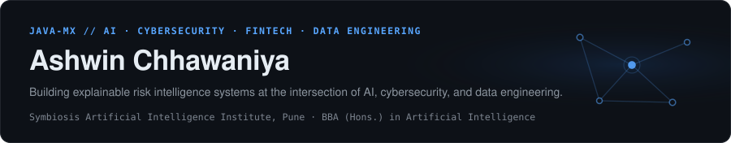

  <picture>
    <source media="(prefers-color-scheme: dark)" srcset="./assets/header-dark.svg" />
    <source media="(prefers-color-scheme: light)" srcset="./assets/header-light.svg" />
    
  </picture>

  Pune, India &nbsp;·&nbsp;
  <a href="https://ashes.base44.app/">Portfolio</a> &nbsp;·&nbsp;
  <a href="https://www.linkedin.com/in/mxfed/">LinkedIn</a> &nbsp;·&nbsp;
  <a href="https://github.com/Java-Mx">GitHub</a> &nbsp;·&nbsp;
  <a href="mailto:ashwinchhawaniya2@gmail.com">Email</a>

---

## About Me

I am an undergraduate student pursuing a **BBA (Hons.) in Artificial Intelligence (FinTech & Cybersecurity)** at the **Symbiosis Artificial Intelligence Institute, Pune** (`2025–Present`).

My engineering work focuses on turning raw technical telemetry—vulnerability feeds, exposure metadata, and real-time operational streams—into **structured, explainable, and auditable decision systems** rather than opaque black-box outputs. Across my projects, I prioritize normalized data modeling, explicit rule-based scoring, reproducible pipelines, and clear analytical interfaces.

### Currently Exploring
- **Security & Vulnerability Intelligence:** Deterministic scoring over NVD CVE 2.0, CVSS, EPSS, and KEV signals.
- **Data & Database Engineering:** Relational modeling (3NF), audit trails, and real-time ingestion pipelines.
- **Native Systems Engineering:** Building memory-safe protocol and cryptographic cores in Rust (`PyO3` / `Maturin`).
- **Decentralized Networking:** Cross-platform peer-to-peer mesh communication over Bluetooth LE and local networks.

---

## Technology Stack

Technologies below are grouped by domain and separated by depth of use across my projects and coursework.

### Programming & Core Languages

  <picture>
    <source media="(prefers-color-scheme: dark)" srcset="https://skillicons.dev/icons?i=py,rust,html,css,js&theme=dark" />
    <source media="(prefers-color-scheme: light)" srcset="https://skillicons.dev/icons?i=py,rust,html,css,js&theme=light" />
    
  </picture>

| Tier | Languages |
| :--- | :--- |
| **Core / Regularly Used** | Python, SQL |
| **Expanding / Systems Focus** | Rust (`PyO3`, `Maturin`) |
| **Project-Specific** | HTML, CSS, JavaScript |

### Data, Analytics & ML Engineering

  <picture>
    <source media="(prefers-color-scheme: dark)" srcset="./assets/pandas-dark.svg" />
    <source media="(prefers-color-scheme: light)" srcset="https://cdn.jsdelivr.net/gh/devicons/devicon@latest/icons/pandas/pandas-original.svg" />
    
  </picture>&nbsp;&nbsp;
  &nbsp;&nbsp;
  &nbsp;&nbsp;
  &nbsp;&nbsp;
  &nbsp;&nbsp;
  <picture>
    <source media="(prefers-color-scheme: dark)" srcset="./assets/sqlalchemy-dark.svg" />
    <source media="(prefers-color-scheme: light)" srcset="https://cdn.jsdelivr.net/gh/devicons/devicon@latest/icons/sqlalchemy/sqlalchemy-original.svg" />
    
  </picture>

  <picture>
    <source media="(prefers-color-scheme: dark)" srcset="https://skillicons.dev/icons?i=pytorch,sklearn,fastapi&theme=dark" />
    <source media="(prefers-color-scheme: light)" srcset="https://skillicons.dev/icons?i=pytorch,sklearn,fastapi&theme=light" />
    
  </picture>

| Tier | Libraries & Platforms |
| :--- | :--- |
| **Core / Regularly Used** | Pandas, NumPy, Streamlit, Jupyter, Power BI, pydeck |
| **Project-Specific** | Scikit-Learn, Plotly, SQLAlchemy, FastAPI, PyTorch, NetworkX, ReportLab |

### Databases & Infrastructure

  <picture>
    <source media="(prefers-color-scheme: dark)" srcset="https://skillicons.dev/icons?i=mysql,postgres,sqlite&theme=dark" />
    <source media="(prefers-color-scheme: light)" srcset="https://skillicons.dev/icons?i=mysql,postgres,sqlite&theme=light" />
    
  </picture>
  &nbsp;&nbsp;
  <picture>
    <source media="(prefers-color-scheme: dark)" srcset="https://skillicons.dev/icons?i=docker,git,github,linux&theme=dark" />
    <source media="(prefers-color-scheme: light)" srcset="https://skillicons.dev/icons?i=docker,git,github,linux&theme=light" />
    
  </picture>

| Category | Core / Regularly Used | Project-Specific |
| :--- | :--- | :--- |
| **Databases** | MySQL, PostgreSQL | SQLite |
| **Infrastructure & Tools** | Git, GitHub, Docker, Linux Terminal, Google Colab, APScheduler, LaTeX, Markdown | GitHub Actions CI, WinGet Packaging |

### Cybersecurity & Risk Intelligence Domain

| Focus Area | Applied Practice |
| :--- | :--- |
| **Vulnerability Intelligence** | NVD CVE 2.0 ingestion, CVSS / EPSS / KEV enrichment, rule-based prioritization |
| **Risk Modeling** | Deterministic scoring engines, canonical validation schemas, auditable decision outputs |
| **Security Data Engineering** | Third Normal Form (3NF) vulnerability schemas, remediation tracking, audit logging |
| **Privacy & Governance** | GDPR data privacy principles, exposure analysis, transparent reporting |

---

## Featured Projects

### 1. ACDRIS — Airspace Conflict Detection & Risk Intelligence System
`Python` · `APScheduler` · `PostgreSQL / MySQL` · `Streamlit` · `pydeck` · `OpenSky Network API`  
**Status:** Completed end-to-end architecture *(private / not currently published)*

A five-layer real-time surveillance and risk-intelligence pipeline designed as a **decision-support and business-intelligence layer**—explicitly not an air traffic control replacement.
- Ingests live ADS-B telemetry across the Indian FIR (`8°–37°N, 68°–97°E`) via the OpenSky Network API with automated scheduling through `APScheduler`.
- Implements a Haversine-based proximity engine and a four-factor deterministic risk model (horizontal separation, vertical separation, closing speed, and flight phase) benchmarked against ICAO Doc 4444 minima (`5 NM` horizontal / `1,000 ft` vertical).
- Maps conflict scores into a tiered severity framework (`Critical / High / Medium / Low`) rendered on a live `Streamlit` + `pydeck` dashboard backed by a normalized SQL schema for reproducible audits.

---

### 2. CTVAM — Cybersecurity Threat & Vulnerability Analysis Model
`Python` · `Pandas` · `Streamlit` · `SQLAlchemy` · `PostgreSQL` · `ReportLab` · `NVD CVE 2.0`  
**Repository:** [Java-Mx/CTVAM-VulnerabilityAnalysisModel](https://github.com/Java-Mx/CTVAM-VulnerabilityAnalysisModel) · **Status:** Public · Apache-2.0

A modular vulnerability analytics and prioritization framework converting raw NVD feeds into structured, explainable assessments.
- Ingests and preprocesses NVD CVE 2.0 JSON/CSV data with CVSS, EPSS, and KEV enrichment plus temporal delta analysis.
- Applies structured rule-based prioritization to isolate high-impact vulnerabilities without relying on opaque scoring.
- Generates explainable analytical views and structured PDF reports suited for technical and decision-making workflows.

---

### 3. Project 19 — Deterministic Cyber Risk Intelligence
`Python` · `NVD CVE` · `Canonical Schemas` · `Rule-Based Scoring`  
**Status:** Completed framework *(private repository)*

A judgment-first cyber risk intelligence system built around strict schema validation, traceable logic, and auditable outputs.
- Ingests and validates real-world NVD CVE records against canonical data schemas with explicit readiness gating.
- Defines transparent priorities, rules, and thresholds so every risk score remains reproducible and inspectable.
- Translates technical vulnerability signals into executive-ready risk summaries without black-box ML dependencies.

---

### 4. VMDB-OSS — Vulnerability Management Database for Open-Source Software
`MySQL` · `3NF Relational Modeling` · `SQL Views` · `Stored Procedures`  
**Repository:** [Java-Mx/VMDB-OpenSourceSoftware](https://github.com/Java-Mx/VMDB-OpenSourceSoftware) · **Status:** Public · MIT

A normalized relational database architecture modeling enterprise open-source vulnerability management and software supply-chain tracking.
- Implements a Third Normal Form (3NF) MySQL schema across 7 core tables linking users, projects, packages, CVEs, remediation actions, and audit logs.
- Enforces data integrity with foreign-key constraints, `CHECK` constraints, and `ENUM`-based remediation status lifecycles.
- Includes operational SQL views and stored procedures for remediation workflows, compliance auditing, and security reporting.

---

### 5. AERIS — Autonomous Exposure & Risk Intelligence System (`Internet-Exposure-Engine`)
`Python` · `FastAPI` · `Streamlit` · `Scikit-Learn` · `PyTorch` · `NetworkX` · `Docker`  
**Repository:** [Java-Mx/Internet-Exposure-Engine](https://github.com/Java-Mx/Internet-Exposure-Engine) · **Status:** Public · Apache-2.0

An explainable exposure-analysis engine that inspects publicly available internet metadata to identify and score digital security risks proactively.
- Combines graph analysis (`NetworkX`), anomaly detection, and transparent risk-scoring modules to produce interpretable exposure reports.
- Ships with an interactive `Streamlit` dashboard, `FastAPI` backend layer, `SQLAlchemy` persistence, and `ReportLab` PDF reporting.
- Structured with automated `pytest` coverage, CI workflows, dataset audit documentation, and container deployment configurations (`Docker` / Kubernetes).

---

### 6. BitChat RustPy — Encrypted Peer-to-Peer Mesh Messaging
`Python` · `Rust` · `PyO3 / Maturin` · `Noise XX` · `Bluetooth LE` · `LAN Mesh`  
**Repository:** [Java-Mx/bitchat-rustpy](https://github.com/Java-Mx/bitchat-rustpy) · **Status:** Active (`v0.3.4`) · MIT · Distributed on Microsoft WinGet

An offline-first, terminal-native encrypted mesh communication system operating over Bluetooth Low Energy and local networks without centralized servers.
- Accelerates protocol and cryptographic internals through a native Rust core (`_bitchat_core`) implementing Noise XX handshakes, AEAD/Ed25519 primitives, mesh routing, and store-and-forward queuing.
- Supports cross-platform BLE and LAN transports with protocol interoperability across native TUI clients (`bitchat-tui`).
- Packaged across Windows installers, Linux `.deb`/AppImage artifacts, Python wheels, and merged community manifests in [microsoft/winget-pkgs](https://github.com/microsoft/winget-pkgs).

> *Additional public repositories: [Customer-Complaint-NLP](https://github.com/Java-Mx/Customer-Complaint-NLP) (TF-IDF & cosine-similarity NLP categorization pipeline) · [Finance-Management-Model](https://github.com/Java-Mx/Finance-Management-Model) (Python & MySQL personal finance system).*

---

## Education & Certifications

### Education
- **BBA (Hons.) in Artificial Intelligence** — *FinTech & Cybersecurity Focus*  
  Symbiosis Artificial Intelligence Institute, Pune · `2025–Present`
- **Senior Secondary (CBSE)** — Delhi Public School, Bhopal · `2024–2025` *(90% / CGPA 9.0)*

### Certifications

| Credential | Issuing Organization | Focus Area | Year |
| :--- | :--- | :--- | :---: |
| GDPR Certification | Udemy | Data Privacy Compliance | 2026 |
| Advanced SQL | HackerRank | Relational Databases | 2026 |
| Problem Solving (Intermediate) | HackerRank | Algorithmic Reasoning | 2026 |
| CEH v13: Introduction to Ethical Hacking | Skillsoft | Ethical Hacking | 2025 |
| Azure Fundamentals: IoT & AI | Skillsoft | Cloud Fundamentals | 2025 |
| DELF A2 & DELF A1 (French) | Alliance Française de Bhopal | CEFR A2 / A1 Proficiency | 2024–2025 |

---

## Current Focus

| Active Work | Next / Exploring |
| :--- | :--- |
| Refining deterministic vulnerability and exposure risk-scoring pipelines (`CTVAM`, `AERIS`) | Deepening Rust systems engineering for async networking and standalone native binaries |
| Migrating protocol, state, and transport layers to native Rust in `bitchat-rustpy` and maintaining WinGet releases | Applying real-time data engineering and explainable analytics to FinTech risk problems |
| Designing normalized relational schemas and auditable security reporting workflows | Building reproducible validation and evaluation harnesses for decision-support systems |

---

## GitHub Activity

  
  

---

## Connect

- **Portfolio:** [ashes.base44.app](https://ashes.base44.app/)
- **LinkedIn:** [linkedin.com/in/mxfed](https://www.linkedin.com/in/mxfed/)
- **GitHub:** [github.com/Java-Mx](https://github.com/Java-Mx)
- **X:** [@Itz_JavaMx](https://x.com/Itz_JavaMx)
- **Email:** [ashwinchhawaniya2@gmail.com](mailto:ashwinchhawaniya2@gmail.com)
- **Location:** Pune, Maharashtra, India
